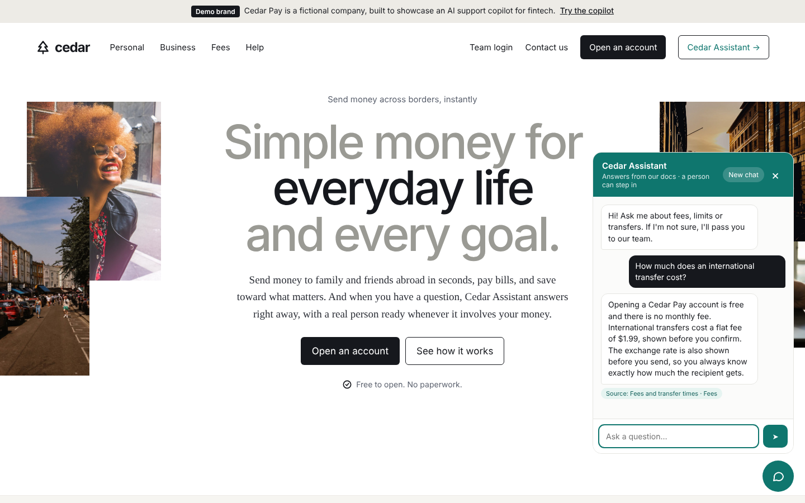
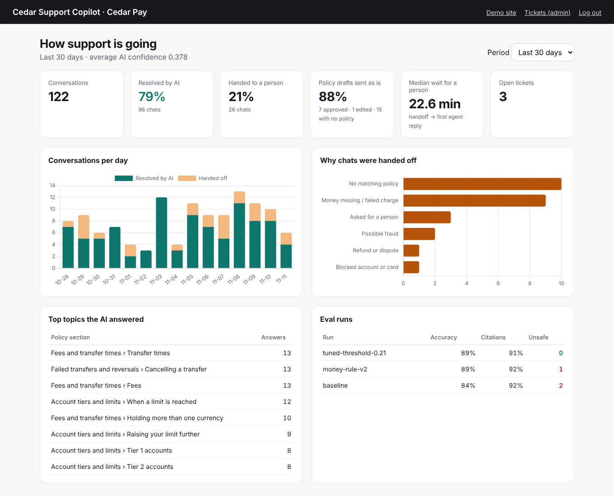

# Cedar Support Copilot

An AI support layer for fintech companies. It answers customers **only from the company's own documents**, shows the **source** for every answer, and **hands off to a person** when it isn't confident or when the customer's money is involved. Support agents get a drafted reply to approve.

It's shown on **Cedar Pay**, a fictional money app built as a demo brand.

| Chat widget | Team dashboard |
|---|---|
|  |  |

*Dashboard numbers come from `simulate_traffic` demo data; the eval runs are real.*

## Status

| Day | Goal | Status |
|-----|------|--------|
| 1 | Project setup: Django, Postgres + pgvector, data models, admin | ✅ Done |
| 2 | Document upload: chunking, embeddings, injection guard, search API | ✅ Done |
| 3 | Chat API: retrieval, answers with citations, "I don't know" and handoff | ✅ Done |
| 4 | Human handoff: money-safety rule, agent inbox, drafted replies | ✅ Done |
| 5 | Evals: 38-question test set, scoring, threshold tuning, run history | ✅ Done |
| 6 | Embeddable chat widget, demo page, analytics API and dashboard | ✅ Done |
| 7 | Deploy to Render (one-click Blueprint), demo video | ✅ Ready to deploy |

## Tech stack

- **Backend:** Django 5 + Django REST Framework
- **Database and vector search:** PostgreSQL 16 with pgvector (HNSW index, cosine distance)
- **AI:** pluggable embeddings and answers (offline by default; any OpenAI-compatible API such as OpenAI, Groq or Gemini)
- **Testing:** Django tests, eval set, Postman collection

## Project layout

```
config/      settings and URLs
core/        Business and staff accounts, health check
knowledge/   Documents and chunks (embeddings for retrieval)
support/     Conversations, messages, citations, handoff tickets
evals/       Test questions, eval runs and results
```

## Run it locally

Requirements: Python 3.11+, Docker.

```bash
# 1. Start Postgres with pgvector
docker compose up -d

# 2. Install dependencies
python -m venv .venv
source .venv/bin/activate        # Windows: .venv\Scripts\activate
pip install -r requirements.txt

# 3. Configure
cp .env.example .env

# 4. Create the tables and an admin user
python manage.py migrate
python manage.py createsuperuser

# 5. Run
python manage.py runserver
```

Load the Cedar Pay demo (business, a staff login and three sample policy docs):

```bash
python manage.py seed_demo --password choose-a-password
python manage.py ask "How long does a transfer to Spain take?"
```

- Admin: http://127.0.0.1:8000/admin/
- Health check: http://127.0.0.1:8000/api/health/ returns `{"status": "ok", "pgvector": "<version>"}`

## API (so far)

Staff endpoints need a signed-in staff user (session or `/api-auth/login/`). Chat endpoints use the business's public widget key plus a secret per-conversation token, and are rate limited (`CHAT_RATE_LIMIT`, default 30/min).

| Method | Endpoint | What it does |
|--------|----------|--------------|
| GET | `/api/health/` | App and pgvector status (public) |
| GET / POST | `/api/documents/` | List documents, or add one: `source_type` = `pdf` (multipart `file`), `url` (`source_url`) or `text` (`text`) |
| GET / DELETE | `/api/documents/<id>/` | View or remove a document and its chunks |
| POST | `/api/documents/<id>/reprocess/` | Re-run ingestion (PDF/URL) |
| POST | `/api/search/` | `{"query": "...", "k": 5}` → closest chunks with scores |
| POST | `/api/chat/` | **Public (widget).** `{"widget_key", "message", "conversation_token"?}` → reply, confidence, citations, `handed_off` |
| GET | `/api/chat/<conversation_token>/?widget_key=…` | **Public (widget).** Chat history with citations |
| GET | `/api/tickets/?status=pending&mine=true` | Agent inbox, oldest first |
| GET | `/api/tickets/<id>/` | Ticket with summary, conversation, suggested reply and its sources |
| POST | `/api/tickets/<id>/assign/` | Assign to yourself, or `{"user_id": n}` |
| POST | `/api/tickets/<id>/reply/` | `{"use_draft": true}` sends the suggestion; `{"content": "..."}` sends your own or edited text; add `"close": true` to resolve |
| POST | `/api/tickets/<id>/redraft/` | Regenerate the summary and draft |
| POST | `/api/tickets/<id>/close/` | Resolve; the chat returns to the AI if the customer writes again |
| GET | `/api/evals/runs/` and `/api/evals/runs/<id>/` | Eval history with per-question results |
| GET | `/api/analytics/?days=30` | Dashboard metrics: AI resolution and handoff rates, reasons, top topics, draft use, wait time, daily volume, eval runs |

## How ingestion works

1. **Extract** text from the PDF, web page or pasted text.
2. **Guard** against prompt injection: lines that read like orders to an AI ("ignore previous instructions…") are removed and listed on the document as `flagged_lines`.
3. **Chunk** by section: each Markdown heading starts a new chunk and stays at its top, with ~200-token chunks and a small overlap inside long sections.
4. **Embed** each chunk (with the document title for context) and store it in pgvector with an HNSW cosine index.

Embeddings are pluggable via `EMBEDDING_PROVIDER`:
- `local` (default): offline hashing embedder, no API key, good for development and tests.
- `openai`: any OpenAI-compatible embeddings API; set `LLM_API_KEY`, `EMBEDDING_MODEL` and, if needed, `LLM_API_BASE`. Run `reprocess` on existing documents after switching.

## Add the chat widget to any site

```html
<script src="https://YOUR-HOST/static/widget/cedar-widget.js"
        data-widget-key="wk_..."
        data-title="Cedar Assistant"
        data-accent="#0F766E" defer></script>
```

The widget is plain JavaScript in a shadow DOM (the host page's CSS can't break it, and it can't break the host page). It shows source chips under answers, tells the customer when a person has taken over, polls for agent replies, and keeps the conversation across page loads. The chat endpoints allow cross-origin calls and ignore cookies, so a logged-in staff session can never be used through the widget.

Pages:
- `/`: Cedar Pay demo page with the widget.
- `/dashboard/`: staff dashboard (log in with a staff user, e.g. the one `seed_demo --password` creates).
- `python manage.py simulate_traffic`: fills the dashboard with demo conversations through the real pipeline (`--clear` removes them).

## How a chat turn works

1. The customer's message is saved.
2. If the chat is already with a person, the AI stays quiet.
3. **Money-safety rule:** failed charges, missing money, fraud, refunds and blocked accounts or cards always go to a person, however confident retrieval is. A policy can say "reversals arrive within 24 hours", but only a person can check what happened to *this* customer's money.
4. If the customer asks for a person ("can I talk to someone?"), it hands off.
5. Otherwise it retrieves the closest policy sections. The top score is the **confidence**.
6. Below the business's threshold → **hand off**: the chat is escalated and a ticket is created.
7. Otherwise the answer step writes a reply **only from those sections**, citing them as `[1]`, `[2]`. If the model says the sources don't answer it, or the model is down, it hands off instead of guessing.
8. The reply is saved with its citations (document and section).

## When a person takes over

Every handoff creates (or reopens) a ticket with:
- a one-line **summary**: why it was handed off, what the customer said, and the related policy;
- a **suggested reply** built only from the matching policy, with its **sources**, ending with the right next step (e.g. asking for the transaction reference);
- an honest placeholder instead of a guess when no policy matches; the agent must write that reply themselves.

Agents approve the draft, edit it, or write their own. Each ticket records which (`draft_outcome`), so Day 6's analytics can show how often drafts are used as is.

Answers are pluggable via `LLM_PROVIDER`:
- `local` (default): no model, replies with the best-matching policy section. Grounded and cited, but not conversational.
- `openai`: any OpenAI-compatible chat API. Set `LLM_API_KEY`, `LLM_CHAT_MODEL` and `LLM_API_BASE`, for example `https://api.openai.com/v1`, `https://api.groq.com/openai/v1` or `https://generativelanguage.googleapis.com/v1beta/openai`.

The confidence threshold defaults to 0.2 for the offline embedder and 0.45 for real embeddings; set it per business in the admin. Day 5's evals are how to tune it.

Try it after `seed_demo` and `runserver`:

```bash
curl -s localhost:8000/api/chat/ -H 'Content-Type: application/json' \
  -d '{"widget_key": "<from seed_demo output>", "message": "How long does a transfer to Spain take?"}'
```

## Evals: measured, not guessed

`evals/fixtures/cedar_pay_evals.json` holds 38 test questions: 25 the copilot should answer (with the document, section and key facts expected), 8 money or account problems, 1 request for a person and 4 off-topic questions it should hand off.

```bash
python manage.py load_evals
python manage.py run_evals --label baseline          # scores and saves a run, shows what changed vs the last one
python manage.py run_evals --sweep 0.15,0.2,0.25,0.3  # compare thresholds without saving
```

Each question runs through the real chat pipeline inside a transaction that is rolled back, so evals leave no chats or tickets behind. Every run records:

| Metric | Meaning |
|--------|---------|
| Accuracy | Fully correct: right routing, right source section, key facts in the answer |
| Routing accuracy | Answered vs handed off correctly (and for the right reason) |
| Citation accuracy | Of the answers given, how many cite the expected section |
| Handoff rate | Share of questions sent to a person |
| **Unsafe answers** | Should have gone to a person, but the AI answered. Target: 0 |
| Missed answers | The AI could have answered, but handed off |

### Results so far (offline embedder, local answers)

| Run | Change | Accuracy | Routing | Citations | Unsafe | Missed |
|-----|--------|---------:|--------:|----------:|-------:|-------:|
| baseline | — | 84.2% | 89.5% | 91.7% | **2** | 1 |
| money-rule-v2 | Fraud rule also catches "it wasn't me" and "a payment I don't recognise" | 89.5% | 94.7% | 91.7% | **1** | 1 |
| tuned-threshold-0.21 | Threshold chosen by sweep: lowest with zero unsafe answers | 89.5% | 94.7% | 91.3% | **0** | 2 |

The remaining misses are retrieval limits of the offline hashing embedder (for example "weekend" vs "weekends ... next business day"). The next run to record is the same set with real embeddings (`EMBEDDING_PROVIDER=openai`).

Caveat: the threshold was tuned on this same 38-question set, so add new questions over time rather than tuning only to these.

## Deploy to Render

The repo is a [Render Blueprint](https://render.com/docs/infrastructure-as-code): `render.yaml` creates the web service and a Postgres database (pgvector is enabled by the first migration).

1. Sign in to [Render](https://dashboard.render.com) with GitHub.
2. **New → Blueprint**, pick this repository.
3. Enter a `DEMO_ADMIN_PASSWORD` when asked, then **Apply**.

`build.sh` installs dependencies, collects static files, migrates, and loads the Cedar Pay demo (docs, eval set, a baseline eval run and demo traffic). Every step is safe to repeat on later deploys.

After it's live:
- `https://<your-service>.onrender.com/`: demo site with the chat widget
- `/dashboard/`: log in as `admin` with your `DEMO_ADMIN_PASSWORD`
- `/admin/`: Django admin

Production settings turn on when `DJANGO_DEBUG=false`: HTTPS redirect (health checks exempt), secure cookies, HSTS, WhiteNoise for static files, and a hard failure if no secret key is set.

Free-plan notes: the web service sleeps after inactivity (the first request takes ~1 minute), and Render's free Postgres expires after 30 days unless upgraded.

## Tests

```bash
python manage.py test
```

The tests use the same Postgres database server (Django creates a temporary test database), including a check that vector search returns the nearest chunk.

## Credits

Demo photos on the Cedar Pay home page: Nappy (NappyStock) and Pexels (helloiamtugce, aleksandar069, Sadi Hockmüller).

## Author

Michael Adekunle · [GitHub](https://github.com/Pennymic81) · [LinkedIn](https://linkedin.com/in/michael-adekunle-01776a3b1)
